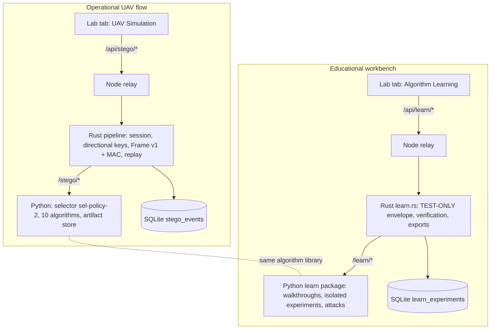

# Algorithm Learning workbench (educational)

The Steganography Lab has two tabs that never share state:

* **UAV Simulation — Live/Operational Flow**: the real K4 image transport (`/api/stego/*`).
* **Algorithm Learning — Worked Calculations and Experiments**: this workbench (`/api/learn/*`).

## 1. Separation

Guarantees (each enforced by a test):
* No session, group key, sequence number, replay window, `stego_events` row or operational artifact is read or written by the workbench (`rust-core/tests/learn_workbench.rs::learning_experiments_never_touch_operational_state`, `python-service/tests/test_learn_workbench.py`).
* The operational selector/pipeline never imports or calls the workbench; the workbench never imports the operational service or artifact store.
* Rust only forwards whitelisted paths (`/learn/registry`, `/learn/walkthrough/<one of 10>`, `/learn/experiment`).
* Separate labels everywhere: UI tabs and banner, `"operational": false`, `"label": "Educational experiment - not a live UAV transmission"` in every response, record and export.

## 2. Views
1. **Walk me through the mathematics** — deterministic Step 1…n calculations on fixed inputs (the 8×8 hand matrix and the synthetic bytes `A6 3C 91 5E`), each step with formula, substituted values and result, plus "show detailed calculations" tables/matrices (DCT coefficients, Haar sub-bands, U/Σ/Vᵀ, cost maps, STC parity-check matrix and Viterbi choice). Every walkthrough ends with an extraction and exact-match check. HUGO, WOW and S-UNIWARD are labelled **teaching models** with their simplification stated (small patch, mini STC with h = 2 instead of 7); their numbers still come from the runtime cost functions and are cross-checked (HUGO cost = brute-force HUGO distortion; S-UNIWARD cost = direct relative change). Generated document: [`worked-examples.md`](worked-examples.md).
2. **Run actual example** — one algorithm on a sample cover or an uploaded PNG (≤ 512×512): embedding, PNG encode, extraction from the decoded PNG, metrics, images (cover, stego, |difference|×64, changed locations, algorithm-specific map: LSB plane, pair differences, edge mask, Haar HH, per-block σ₁, or log cost map), click-to-inspect pixel values, verification, optional robustness suite.
3. **Compare all ten** — the same cover array and the same payload bytes for every algorithm; insufficient capacity is reported as `rejected_capacity` (never shortened). Metrics table, robustness matrix, per-algorithm detail.

## 3. Payload modes
* **Readable message → real encryption** (`aead_fixture`): the message (default `UAV_ID=D1 / TARGET=D2 / LAT=9.45 / LON=77.80 / ALT=120`) is UTF-8 serialised and sealed by the production `seal_message` + AppWire v1 code with a **test-only key** = HKDF-SHA256 of a public label (not secret, never used for UAV traffic, never displayed). The UI shows plaintext length, wire length (50-byte header + ciphertext incl. 16-byte tag), hex and binary previews. After extraction the Rust core decodes the AppWire and AEAD-opens it: `aead_verified` + `plaintext_matches`. The same AppWire bytes are embedded by all algorithms (the operational Frame v1 wrapper, +44 bytes and algorithm-bound, is reported but not included, so the comparison is fair).
* **Synthetic ciphertext** (`synthetic`): `A6 3C 91 5E`, MSB-first. Labelled as a synthetic byte sequence, **not** a real ciphertext; verification is `not_applicable_synthetic` (bit-exactness only).

## 4. Metrics (consistent definitions)
| Metric | Definition |
|---|---|
| MSE | mean over all pixel×channel samples of (cover − stego)² |
| PSNR | 10·log10(255²/MSE); `null` = identical images (infinite) |
| SSIM | mean SSIM, uniform 7×7 window, K1 = 0.01, K2 = 0.03, L = 255, over all windows and channels (numpy, `stego/metrics.py`) |
| Capacity | raw = algorithm capacity excluding the bootstrap (estimated from the cover); verified = largest payload actually embedded and extracted in a verification run |
| Payload size | plaintext bytes (AEAD mode), wire bytes, overhead, bits, bits per pixel |
| Embedding time | `perf_counter` around `codec.embed_frame`; cost-map setup reported separately for STC methods |
| Extraction time | PNG decode + bootstrap validation + extraction |
| Accuracy | matching bits / expected bits, matching bytes / expected bytes |
| BER | (wrong + missing bits) / expected bits; 1.0 when extraction fails |
| Robustness | per attack: full pipeline (bootstrap + payload) result and oracle BER (direct extraction with known algorithm/length/param); outcome `recovered` / `recovered_oracle_only` / `partial` (oracle BER ≤ 0.1) / `failed` (BER ≈ 0.5 is chance level) |

## 5. Robustness experiment
Fixed attacks and seeds: none; JPEG q95/q75/q50; resize 50% and back (bilinear); crop 4 px (geometry change); Gaussian noise σ=1 (seed 11) and σ=3 (seed 12); salt-and-pepper 0.5% (seed 13); Gaussian blur 3×3 σ=0.8; brightness +2. Nothing is repaired.
Measured result for the sample comparison (`docs/samples/learning-comparison-all-ten.md`, RGB 256×256, 112-byte AEAD payload):
* every algorithm recovers exactly without an attack;
* **every algorithm fails JPEG q95, q75 and q50, the 50 % resize and the 4-px crop** (oracle BER ≈ 0.4–0.55 or desynchronised);
* brightness +2 is survived by nine of ten (it preserves LSB parity away from 255 and does not change AC/HH/σ₁ coefficients); PVD is only partial;
* small noise / blur / salt-and-pepper: no algorithm recovers through the full pipeline (the LSB bootstrap breaks first); DCT, DWT and DCT-SVD sometimes recover the payload bits only with known parameters (oracle BER 0–0.08), and several methods are "partial" under 0.5 % salt-and-pepper.

These are empirical results for these exact parameters and this cover, not general robustness claims; transform-domain operation alone did not give JPEG robustness here.

## 6. Exports
`GET /api/learn/experiments/{id}/export?format=json|csv|md` — the stored record (images stripped, hashes kept). CSV cells are formula-injection neutralised. Samples: `docs/samples/learning-comparison-all-ten.{json,csv,md}` (AEAD mode, robustness) and `docs/samples/learning-synthetic-bw-cover.md` (synthetic bytes on the B/W fallback cover).

## 7. How to run
Start the stack (`scripts/linux/run_demo.sh` or `scripts\windows\run_demo.ps1`), open `http://127.0.0.1:5173/steganography?view=learn`.
API: `GET /api/learn/registry`, `GET /api/learn/walkthrough/{alg}`, `POST /api/learn/experiment`, `GET /api/learn/experiments`, `GET /api/learn/experiments/{id}/export?format=…`.
Regenerate the worked examples: `python3 scripts/gen_worked_examples.py` (Windows: `python scripts\gen_worked_examples.py`).
Tests: `cd python-service && python -m pytest -q tests/test_learn_workbench.py`; `cd rust-core && cargo test --release --test learn_workbench`.

## 8. Limitations
* Teaching models for HUGO/WOW/S-UNIWARD are reduced illustrations (stated in each walkthrough).
* "Saved image" in experiments = an in-memory PNG encode/decode round trip (lossless); the workbench deliberately writes nothing to the operational artifact directory.
* Upload covers ≤ 512×512 PNG; images are inlined as data URIs (large responses, ~2 MB for a ten-algorithm comparison).
* Timings are host-simulation measurements.
