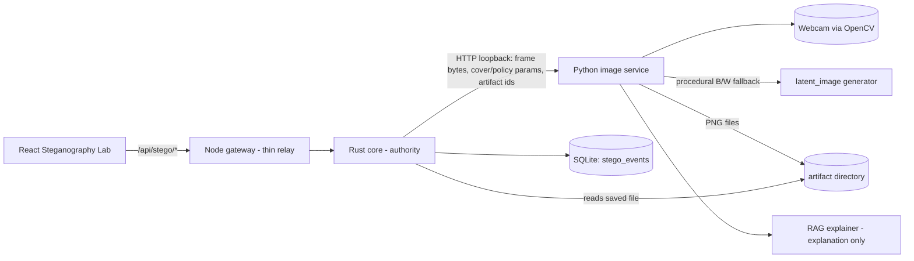
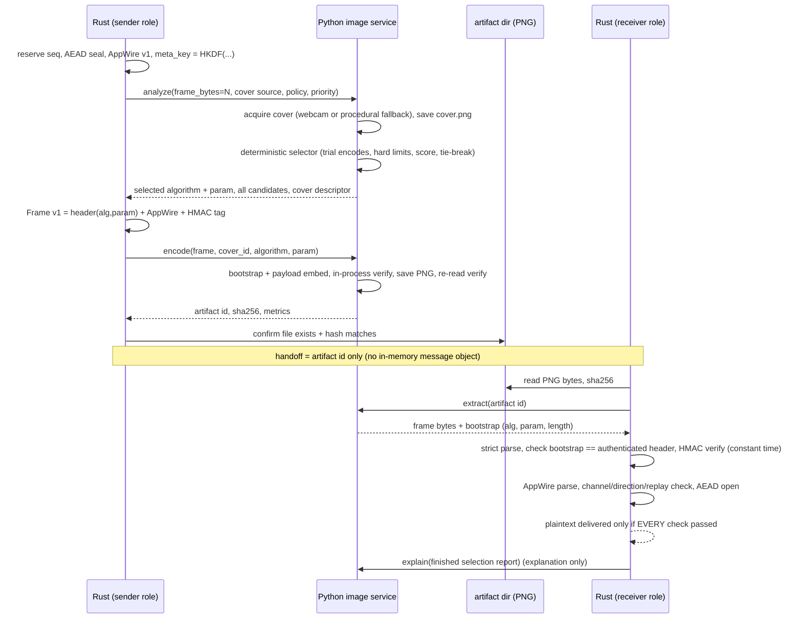

# Steganographic application-message transport

**Status: research prototype.** Application messages (K4) are carried as PNG images after
authentication (M1–M8) and group-key establishment (K1–K3) have completed. Control-plane messages
(M1–M8, K1–K3) are **not** carried over this transport and their code is unchanged.

What this layer is: an additional *carrier* around messages that are already AEAD-encrypted and
metadata-authenticated. What it is not: a replacement for encryption, a robust watermark, or an
anti-steganalysis tool. See [Honest limitations](#honest-limitations).

## 1. Architecture and data flow

Responsibilities (unchanged architecture):

| Component | Does | Never does |
|---|---|---|
| Rust core | AEAD seal/open, directional keys, metadata-MAC key (HKDF), frame build/verify, strict parsing, channel/direction/replay checks, persistence, event/report, final say on every error | send keys or plaintext to any other process |
| Python service | webcam capture, procedural cover, five embedding algorithms, deterministic selector, metrics, PNG save/read, RAG explanation text | accept keys; hold secrets; decide protocol outcomes |
| Node gateway | relay `/api/stego/*` 1:1 (incl. PNG/CSV pass-through) | crypto, policy, algorithm choice |
| React | render, controls, downloads | receive keys; show anything not returned by the backend |

### Send → receive sequence (one message)

## 2. Wire formats (all big-endian)

### 2.1 AppWire v1 (the complete serialized `SecureAppMessage`)

| off | len | field |
|---|---|---|
| 0 | 1 | `wire_version` = 1 |
| 1 | 16 | `channel_tag` (session-derived pseudonym) |
| 17 | 1 | `direction` (1 = D1→D2, 2 = D2→D1) |
| 18 | 4 | `header_seq` |
| 22 | 8 | `header_ts` (ms) |
| 30 | 4 | `sealed.seq` (must equal `header_seq`) |
| 34 | 12 | AEAD nonce |
| 46 | 4 | `ct_len` |
| 50 | `ct_len` | ciphertext ‖ Poly1305 tag |

All fields needed to rebuild the AEAD associated data (`APPMSG` canonical encoding of tag, direction,
seq, ts) are present, so header tampering fails AEAD as well as the frame MAC. No DroneID/PID appears.

### 2.2 Transport Frame v1

| off | len | field |
|---|---|---|
| 0 | 4 | magic `IODF` |
| 4 | 1 | version = 1 |
| 5 | 1 | `alg_id` (1..5) |
| 6 | 1 | `param` |
| 7 | 1 | flags = 0 |
| 8 | 4 | `wire_len` |
| 12 | `wire_len` | AppWire v1 |
| … | 32 | `HMAC-SHA256(meta_key, "IOD-STEGO-FRAME-v1" ‖ header ‖ wire)` |

### 2.3 Bootstrap v1 (fixed, algorithm-independent)

16 bytes in the LSBs of the first 128 samples (row-major, channel-interleaved; MSB-first):

`"SB" | version | alg_id | param | flags(0) | frame_len(4) | reserved(2) | CRC-32(first 12 bytes)`

The receiver can always read it with plain LSB reading, learns the algorithm, parameter and frame
length, and only then runs that algorithm's extractor — there is no circular dependency. The extractor
validates mode, dimensions, magic, version, CRC, algorithm id, flags and that `frame_len` does not
exceed the configured maximum **or** the algorithm's computed capacity for this very image before it
allocates or does any work proportional to the frame. The CRC is an accidental-corruption check only;
authenticity comes from the Rust-verified frame (below).

## 3. Key derivation and metadata authentication

`meta_key = HKDF-SHA256(ikm = directional AEAD key, salt = none, info = "IOD-STEGO-META-v1" ‖ channel_tag ‖ direction, 32 B)`
using the repository's existing `crypto::kdf::hkdf_expand`. Properties:

* **Separate from the AEAD key** (domain separation); derived and used only inside Rust; never logged,
  serialized, or sent to Python/Node/the browser. The directional AEAD keys themselves come from the
  K1–K3 group-key material exactly as before.
* The MAC covers the header (including `alg_id` and `param`) and the whole encrypted wire payload.
  Tag comparison is constant-time. Receiver order: parse structure → verify MAC → only then trust
  header semantics → require bootstrap `alg_id`/`param`/length to equal the authenticated values
  (`FRAME_ALGORITHM_MISMATCH` otherwise) → parse AppWire → channel/direction/replay → AEAD.
* The bootstrap is unauthenticated by construction (it must be readable first); tampering with it
  can only cause rejection, never acceptance of a different message.
* An ordinary checksum (the bootstrap CRC) is **not** treated as authentication.

## 4. Embedding algorithms

All operate on arbitrary bytes, are deterministic, never touch samples `[0,128)` (bootstrap), verify
capacity before and during embedding, and round-trip exactly through lossless PNG. **None is claimed
robust** to JPEG recompression, resizing, filtering or cropping; the LSB-family methods are the most fragile.
(Details and rationale: `docs/stego-implementation-note.md` §1.4.)

| id | name | rule (summary) | capacity | notes |
|---|---|---|---|---|
| 1 | `lsb_replacement` | bit *i* → LSB of sample 128+*i* | `N−128` bits | statistically detectable (pairs-of-values) |
| 2 | `lsb_matching` | change LSB by ±1 only when needed; 0→+1, 255→−1; PRNG seeded from cover hash | `N−128` bits | avoids the replacement asymmetry; still detectable |
| 3 | `pvd` | adjacent sample pairs; difference range table 3/3/4/5/6/7 bits | image dependent (exact) | pair stays in range; boundary-safe |
| 4 | `edge_adaptive_lsb` | LSB replacement only on pixels whose 7-MSB gradient ≥ T (param, default 6) | eligible pixels × channels | mask uses only MSBs, so cover/stego masks are identical; no fallback to flat areas |
| 5 | `dct` | 8×8 block DCT, 6 mid-frequency coefficients, parity quantisation (Δ = param, default 12); block row 0 skipped | `6 × blocks` | each block re-verified after rounding/clipping; saturated blocks can fail (`ENCODE_VERIFY_FAILED`) |

Image handling: RGB and L only; no resize or lossy step is ever applied; modes other than RGB/L are
converted and the transform recorded; images beyond configured size limits are rejected. The procedural
fallback (black/white, mode `1`) becomes mode `L` with the recorded transform `mode:1->L`.

## 5. Deterministic selector (policy `sel-policy-1`)

Pure function of features + policy. Steps: validate → capacity filter → trial-encode each candidate on
the real cover (measured MSE/PSNR/SSIM) → hard limits (`max_mse`, `min_psnr_db`, `max_cost_units`) →
score → tie-break → report.

`score = w_d·d + w_u·u + w_t·t`, with `d = clamp(1 − PSNR/80, 0, 1)`, `u = frame_bits/capacity_bits`,
`t = est_cost_units/20`; weights by priority class `urgent (0.2,0.1,0.7)`, **`normal (0.5,0.2,0.3)`** (default),
`background (0.8,0.15,0.05)`. The application model has no priority metadata, so every message is `normal`
unless an operator experiments with another class in the Lab. `est_cost_units` is a **static model**, not a
measurement; measured wall-clock times are reported but never ranked, so the choice is reproducible.
Candidates within `tie_epsilon` (0.01) of the best score are tied; the first in
`[lsb_matching, pvd, edge_adaptive_lsb, lsb_replacement, dct]` wins (a documented policy preference).
Output: selected algorithm, `reason_code` (`BEST_SCORE | TIE_BREAK_ORDER | ONLY_ELIGIBLE | MANUAL_OVERRIDE`),
policy version, features, and every candidate with capacity, utilisation, cost, metrics, score and exclusion reason.
Manual override (Lab only) still has to pass capacity and hard limits (`ALGORITHM_NOT_ELIGIBLE` otherwise).
If nothing is eligible the message is rejected (`NO_ELIGIBLE_ALGORITHM`); it is never truncated, fragmented
or downgraded to passthrough.

## 6. RAG = explanation only

After the decision is final, the finished selection report goes to `POST /stego/explain`. The service
retrieves curated, versioned algorithm notes with the existing word-overlap retriever, fills a template
(mock LLM), and **claim-checks** the narrative against the evidence. Rust accepts the response only if it
confirms `selected_unchanged` and echoes the same algorithm; otherwise (or on any outage/timeout) a
deterministic rule-based explanation produced in Rust is used and labelled `fallback_deterministic`.
Delivery never depends on the explanation. The current RAG is **simulated** (word-overlap retrieval and
template text) — it is not a learned selector and cannot choose, rank, or veto an algorithm.

## 7. Cover acquisition and fallback

Default for application messages: webcam via OpenCV (`IOD_STEGO_CAMERA_INDEX`, timeout
`IOD_STEGO_CAPTURE_TIMEOUT_MS`), falling back to the procedural B/W generator with a recorded reason
(`CAMERA_ABSENT`, `CAMERA_PERMISSION_DENIED`, `CAMERA_TIMEOUT`, `CAMERA_BACKEND_UNAVAILABLE`,
`CAMERA_CAPTURE_FAILED`, `CAMERA_DISABLED`). `IOD_STEGO_CAMERA=disabled` forces the fallback. The Lab can
also reuse a previously saved cover (`test_cover`). Install `opencv-python-headless` (see
`python-service/requirements-camera.txt`) to enable the webcam; on Windows the OS camera-privacy setting
must allow desktop apps; on Linux the user needs access to `/dev/video*`. Automated tests use mock adapters
only — **no physical camera was available in the build environment**, so the OpenCV adapter has not been
exercised against real hardware.

## 8. Artifacts, retention, safety limits

* Directory `IOD_STEGO_ARTIFACT_DIR` (default `./data/stego-artifacts`), shared by Rust and Python
  (Docker: named volume `iod-artifacts`). Files: `<uuid4-hex>.png` (stego) and `<uuid4-hex>.cover.png`.
* Every API accepts only the 32-hex id; no client-supplied path is ever opened; files are created exclusively
  and atomically (`tmp` + rename) — one message can never overwrite another.
* Rust re-reads each saved file and checks size/SHA-256 against what Python reported; the receiver hashes the
  file it reads and requires Python's extraction to have seen identical bytes.
* Retention: `IOD_STEGO_RETENTION_MAX_ARTIFACTS` (default `0` = keep everything so reports stay reproducible).
* Limits (Rust is the single source, passed on every call): max image 1920×1080 by default, max frame 64 KiB,
  capture timeout 3 s, HTTP timeout 20 s, response cap 32 MiB; Python additionally enforces hard ceilings.

## 9. Errors (stable codes)

Rust-authoritative: `NO_GROUP_KEY, NO_AUTH_SESSION, SESSION_NOT_ACTIVE, MEMBER_REVOKED, NOT_PARTICIPANT,
WRONG_RECIPIENT, FRAME_TOO_LARGE, FRAME_MALFORMED, FRAME_VERSION_UNSUPPORTED, FRAME_AUTH_FAILED,
FRAME_ALGORITHM_MISMATCH, FRAME_LENGTH_MISMATCH, WIRE_MALFORMED, WIRE_VERSION_UNSUPPORTED, WRONG_CHANNEL,
REPLAY, AEAD_FAILED, ARTIFACT_NOT_FOUND, ARTIFACT_NOT_VISIBLE, ARTIFACT_HASH_MISMATCH, INVALID_ARTIFACT_ID,
STEGO_BACKEND_UNAVAILABLE, STEGO_BACKEND_TIMEOUT, BACKEND_MALFORMED_RESPONSE, BACKEND_RESPONSE_TOO_LARGE,
INVALID_REQUEST, REQUEST_TOO_LARGE`.
From the image service: `FRAME_TOO_LARGE, IMAGE_TOO_LARGE, IMAGE_TOO_SMALL, UNSUPPORTED_IMAGE_MODE,
IMAGE_DECODE_ERROR, BOOTSTRAP_MISSING, BOOTSTRAP_CORRUPT, UNSUPPORTED_VERSION, UNKNOWN_ALGORITHM,
FRAME_LENGTH_INVALID, EXTRACT_FAILED, NO_ELIGIBLE_ALGORITHM, ALGORITHM_NOT_ELIGIBLE, ENCODE_VERIFY_FAILED,
EMBED_VERIFY_FAILED, IMAGE_WRITE_FAILED, COVER_FAILED, INTERNAL_ERROR`.
Every failure is persisted as an event with its code and stage and never delivers a partial message.

## 10. Persistence, events and reports

SQLite table `stego_events` (additive `CREATE TABLE IF NOT EXISTS`, indexed by time): one row per transaction
(`transaction`), send-only or receive-only call. Fields: session, direction, sequence, roles, transport
format version, algorithm/param, selection policy version/mode/reason code, all candidates with scores and
exclusion reasons, explanation status, cover source and fallback reason, dimensions/mode/channels/format,
frame/wire/image sizes, capacity and margin, per-stage timings (`aead_seal, capture, select, embed, save,
read, extract, verify, aead_open, explain, total`), MSE/PSNR/SSIM with `*_defined` flags (null when
undefined), artifact id and hashes, `frame_sha256_prefix` (8-byte correlation id), `frame_match`,
`header_mac_ok`, `aead_ok`, error code/stage. **Never stored:** plaintext, ciphertext, keys, the MAC key,
tokens, the channel tag. Report schema `stego-report-1` (JSON) and a fixed-column CSV (formula-injection
neutralised) are served by `GET /api/stego/report`. Percentiles are `null` unless n ≥ 20.

## 11. Configuration

| Variable | Default | Meaning |
|---|---|---|
| `IOD_PYTHON_URL` | `http://127.0.0.1:5001` | image service (plain HTTP, loopback only unless `IOD_STEGO_ALLOW_NONLOOPBACK=1`) |
| `IOD_STEGO_ARTIFACT_DIR` | `./data/stego-artifacts` | shared PNG directory (Rust **and** Python) |
| `IOD_STEGO_CAMERA` (Python) | `auto` | `auto` or `disabled` |
| `IOD_STEGO_CAMERA_INDEX` | `0` | webcam index (0–16) |
| `IOD_STEGO_CAPTURE_TIMEOUT_MS` | `3000` | capture timeout |
| `IOD_STEGO_MAX_WIDTH` / `_HEIGHT` | `1920` / `1080` | image limits (32–4096) |
| `IOD_STEGO_MAX_FRAME_BYTES` | `65536` | frame limit (64–1 MiB) |
| `IOD_STEGO_HTTP_TIMEOUT_MS` | `20000` | Rust→Python timeout |
| `IOD_STEGO_MAX_MSE`, `_MIN_PSNR_DB`, `_MAX_COST_UNITS` | `4.0`, `40.0`, `1000` | selector hard limits |
| `IOD_STEGO_RETENTION_MAX_ARTIFACTS` (Python) | `0` | 0 keeps all |

Why plain HTTP and a hand-written client: a TLS stack (rustls/ring) would put elliptic-curve code in the
dependency tree, which this project forbids. The Rust↔Python hop is loopback (or a private container network);
it carries only encrypted+MACed frames, cover/policy parameters and artifact ids — never keys or plaintext.
The server handles requests one at a time (`tiny_http`), but the pipeline still never holds the state mutex
across a Python call.

## 12. API summary

`GET /api/stego/status` · `POST /api/stego/camera/probe` · `POST /api/stego/analyze` · `POST /api/stego/message`
(full transaction) · `POST /api/stego/send` · `POST /api/stego/receive` · `GET /api/stego/events[?session_id,direction,algorithm,outcome,since_ms,until_ms,limit]`
· `GET /api/stego/events/{id}` · `GET /api/stego/report?format=json|csv` · `POST /api/stego/benchmark` ·
`GET /api/stego/artifacts/{id}/stego|cover`. The legacy `POST /api/secure-message` now goes through the same
pipeline and returns its old keys plus a `stego` object. Request/response examples: `docs/api.md`.

## Honest limitations

* Lossless PNG hand-off between local components only. No claim of resilience to JPEG/resize/filter/crop.
* No anti-steganalysis claim. LSB-class methods are statistically detectable; payload bits are ciphertext
  (high entropy), which does not make detection impossible.
* The steganographic layer adds obscurity and a carrier, **not** cryptographic strength: confidentiality,
  integrity and replay protection come from the ML-KEM-derived AEAD keys and the HMAC-protected frame.
* Webcam capture was not tested on hardware; only the mocked paths and the procedural fallback are verified.
* RAG is simulated and explanation-only.
* Round-3 PQ crates (Kyber768/Dilithium2), unaudited Plonky3 RC: see `docs/IMPLEMENTATION_STATUS.md`.
* Timings are host-simulation measurements, not drone hardware.
